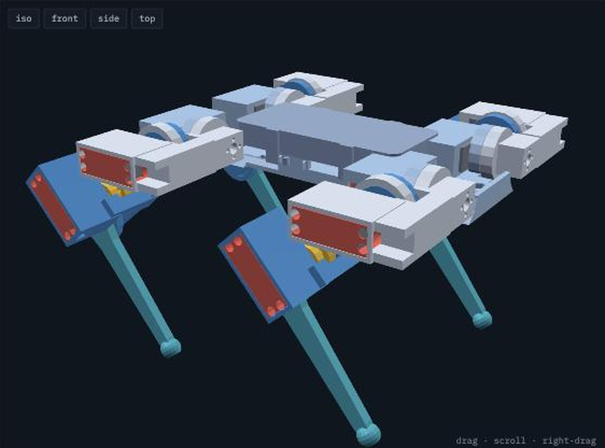
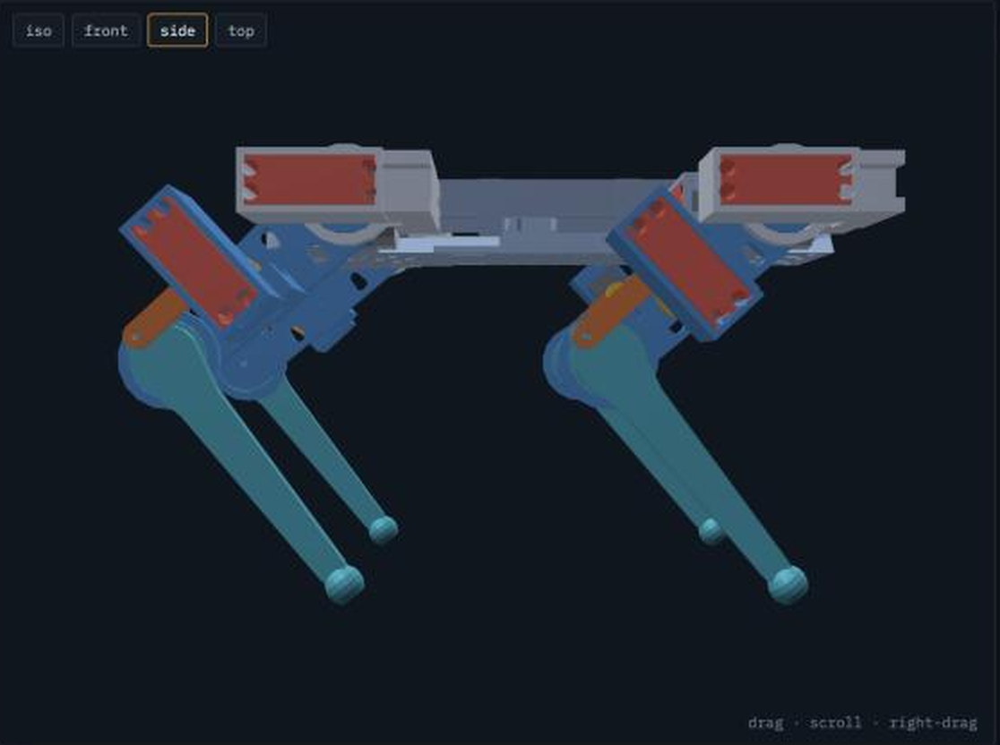
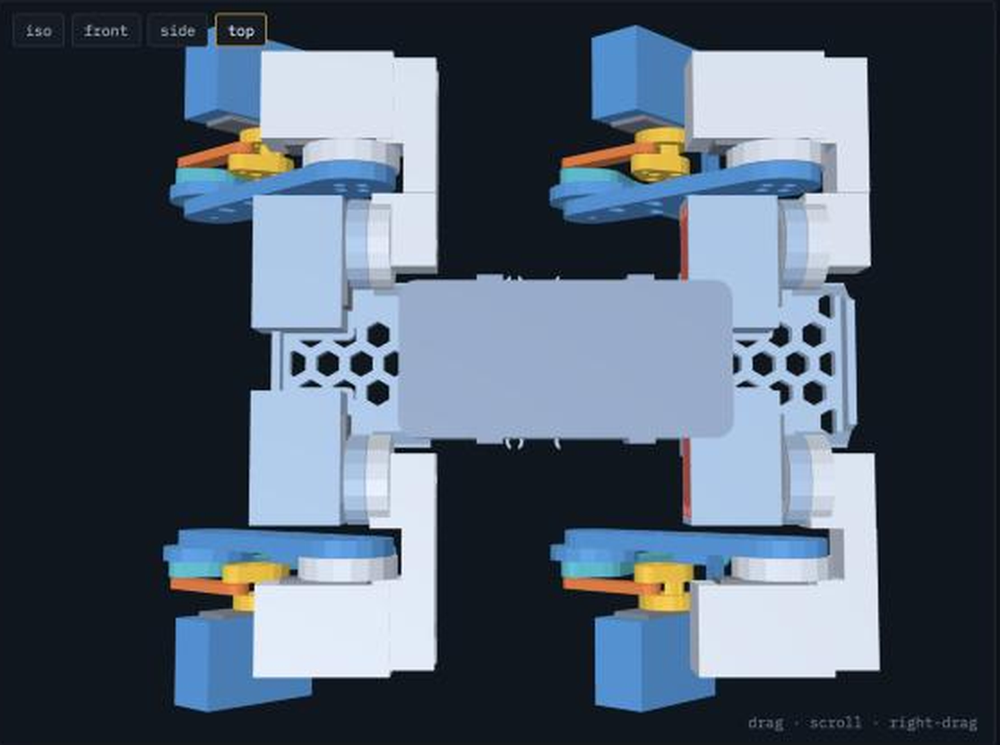

# Quadruped

A 3D-printed walking robot dog. Twelve servos, three per leg, direct
drive at the hip and a parallelogram linkage at the knee.



Every part sits where the kinematic model puts it — the renders here are
the posed assembly itself, generated from the same source as the STLs,
not a drawing of it.

| | |
|---|---|
| mass | 2.06 kg, 769 g of it printed |
| body | 200 × 110 mm hip to hip, 202 mm stance |
| ride height | 186.5 mm |
| joints | 12 × DS3225MG, 25 kg·cm |
| worst walking torque | 15.3 kg·cm — 1.6× inside stall |
| roll travel | ±35° |





## What's here

```
cad/          OpenSCAD source, and the checkers that verify it
cad/stl/      printable parts
docs/         control architecture, AI plan, design notes, images
reference/    the kinematic model the CAD is generated from
viz/          a browser viewer for the posed assembly
PARTS.txt     everything to print and everything to buy
```

**There is no firmware here.** The controller is left to be written
against the Teensy — see [`docs/CONTROL.md`](docs/CONTROL.md) for the
architecture the mechanics were designed around, and
[`docs/AI_MODE.md`](docs/AI_MODE.md) for what comes after.

The Python in `reference/` is not the robot's control code. It is the
design model: closed-form IK, a gait generator and a load solver, used
to size the parts and prove the geometry before anything was printed.
`cad/sync_params.py` reads it and emits the dimensions the CAD builds
from, so the model and the mechanics cannot disagree about a link length.

## Building it

Start with [`PARTS.txt`](PARTS.txt) — every printed part with its
quantity and orientation, every joint with the fastener that makes it,
and everything to order. It is generated from the geometry by
`cad/bom.py`, so the screw lengths are measured off the model rather
than typed.

Three things worth knowing before ordering:

- **Three parts are handed.** Thigh, shank and crank have no mirror
  plane, so it is 2 + 2 of each. The shank is 99.0% self-overlapping and
  the crank 95.2% — they *look* symmetric and are not.
- **Heat-set inserts are specified by outside diameter, not thread.** M3
  inserts come in 4.0 and 4.6 mm OD; these holes want 4.6. A 4.0 insert
  drops into a 4.0 hole and spins.
- **The chassis is split** into two halves with a bolted lap joint,
  because 280 mm does not fit on a 235 mm bed.

## Regenerating

```bash
python3 cad/sync_params.py     # kinematics -> cad/params.scad
bash    cad/export.sh          # -> cad/stl/*.stl
python3 cad/bom.py             # -> the parts list
```

## Checking

The CAD is verified rather than eyeballed. Each of these has caught a
real bug:

```bash
python3 cad/check_fit.py        # 46 part pairs x 180 poses
python3 cad/check_assembly.py   # can each servo be fitted, wired, screwed
python3 cad/check_screws.py     # does each screw reach, and stop in time
python3 cad/check_solid.py      # is every part one connected lump
python3 cad/check_walls.py      # thickness, bending, torsion, journals
python3 cad/check_clearance.py  # exact mm between moving parts
```

`check_fit` is the slow one — every pair at every pose, about twenty
minutes. It is also the one that found the shank reaching the
knee-servo bracket at full fold, which nothing else would have.

Three of these need `numpy` and `scipy`; the rest are stdlib only.

## Design notes

Why a parallelogram instead of a general four-bar, why the roll servo
lies flat, what the journals are for: [`docs/DESIGN-NOTES.md`](docs/DESIGN-NOTES.md),
and the long-form version in the viewer.

```bash
cd viz/robot3d && python3 -m http.server 8000
```

## Status

Mechanically complete and verified; nothing has been assembled yet. Two
dimensions are still assumptions rather than measurements — the servo
horn's bolt circle (15 mm) and the M4 insert pilot — and both are called
out in `PARTS.txt`.
