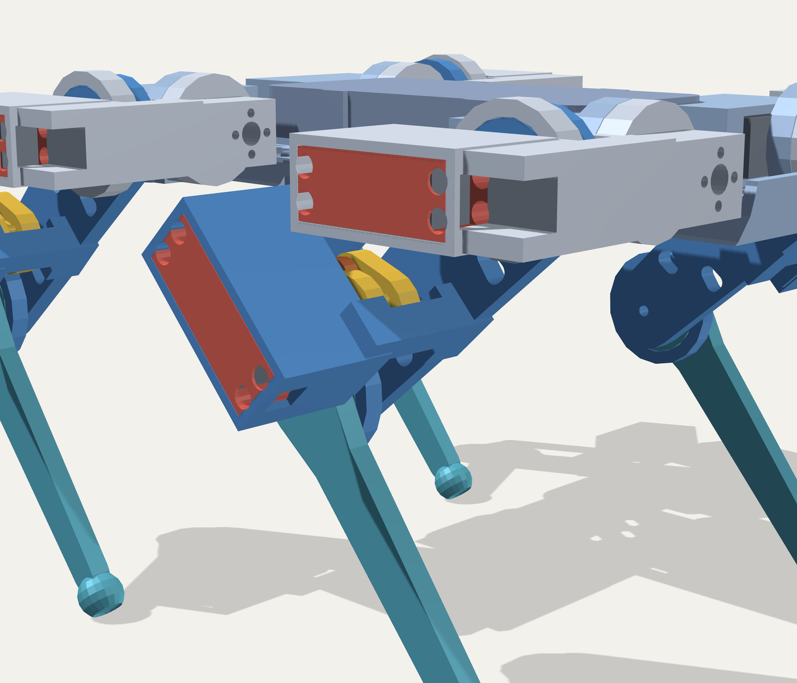

# Quadruped

A 3D-printed walking robot dog. Twelve servos, three per leg, direct
drive at the hip and a parallelogram linkage at the knee.


| | |
|---|---|
| mass | 2.06 kg, 769 g of it printed |
| body | 200 × 110 mm hip to hip, 202 mm stance |
| ride height | 186.5 mm |
| joints | 12 × DS3225MG, 25 kg·cm |
| worst walking torque | 15.3 kg·cm — 1.6× inside stall |
| roll travel | ±35° |


One leg from the outside — roll and pitch servos at the hip, the knee
servo riding on the thigh, and the gold crank it drives the shank with:




## Build it

Everything to print and everything to buy is in
[`PARTS.txt`](PARTS.txt), with the fastener for every joint. Three
things to know before you order:

- **Three parts are handed** — thigh, shank and crank. 2 + 2 of each.
  They look symmetric and are not.
- **Heat-set inserts go by outside diameter, not thread.** M3 inserts
  come in 4.0 and 4.6 mm OD; these holes want 4.6. A 4.0 spins.
- **The chassis prints in two halves** and bolts together. 280 mm does
  not fit on a 235 mm bed.

STLs are in [`cad/stl/`](cad/stl). To regenerate them:

```bash
python3 cad/sync_params.py     # kinematics -> cad/params.scad
bash    cad/export.sh          # -> cad/stl/*.stl
python3 cad/bom.py             # -> PARTS.txt
```

## What's here

```
cad/        OpenSCAD source, STLs, and the scripts that check them
docs/       control plan, AI plan, design notes, images
firmware/   Teensy project — scaffolded, nothing written yet
host/       web control and, later, AI — empty
reference/  the kinematic model the CAD dimensions come from
viz/        browser viewer for the posed assembly
PARTS.txt   print list + shopping list
```

**No firmware yet.** [`firmware/`](firmware) is an empty Teensy 4.1
project: a build config, `config.h` filled in with the geometry and joint
limits the CAD was built from, and one stub per piece. It compiles as it
stands, so you can check your toolchain before writing anything.
[`docs/CONTROL.md`](docs/CONTROL.md) is the spec it's aimed at,
[`docs/AI_MODE.md`](docs/AI_MODE.md) is for later.

The Python in this repo is the design model and the CAD checks, not the
robot's control loop.

## Checking the CAD

```bash
python3 cad/check_fit.py        # 46 part pairs x 180 poses
python3 cad/check_assembly.py   # can each servo be fitted, wired, screwed
python3 cad/check_screws.py     # does each screw reach, and stop in time
python3 cad/check_solid.py      # is every part one connected lump
python3 cad/check_walls.py      # thickness, bending, torsion, journals
python3 cad/check_clearance.py  # exact mm between moving parts
```

`check_fit` takes about twenty minutes and is the one that found the
shank hitting the knee bracket at full fold.

Why a parallelogram, why the roll servo lies flat, what the journals are
for: [`docs/DESIGN-NOTES.md`](docs/DESIGN-NOTES.md).

## Status

Verified in CAD, not yet assembled. Two numbers are still assumptions —
the servo horn's bolt circle (15 mm) and the M4 insert pilot — both
flagged in `PARTS.txt`.
